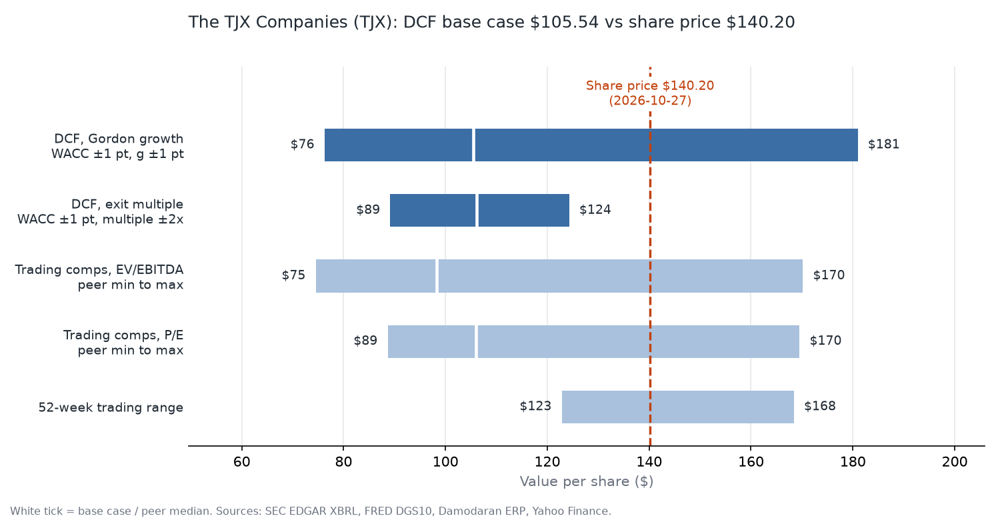
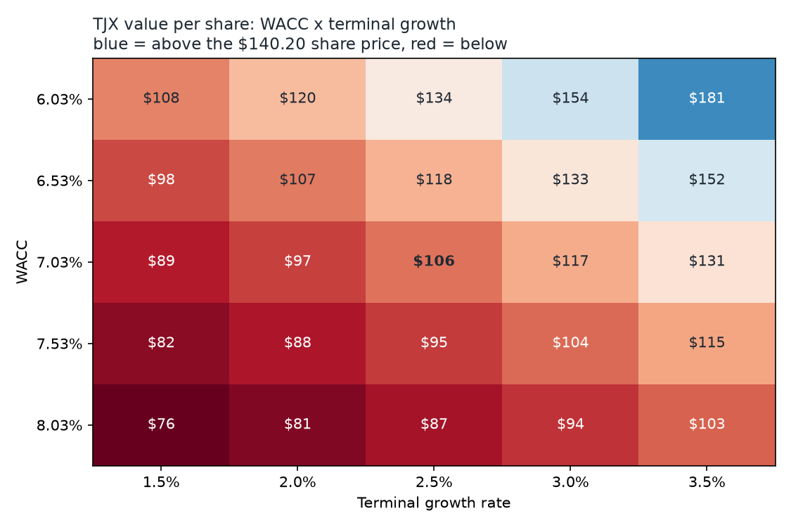

# What is TJX worth? A DCF built from SEC filings

**Question:** is The TJX Companies, Inc. (TJX), the Framingham, Massachusetts off-price retailer, worth its share price of **$140.20** (close on 2026-10-27)?

**Answer from this model:** a five-year unlevered DCF puts intrinsic value at **$105.54 per share** with a Gordon-growth terminal value and **$106.09** with a peer exit multiple, 24.7% and 24.3% below the market price. To justify $140.20 with everything else unchanged, the WACC would have to be 5.88% (model: 7.03%) or the EBIT margin 14.51% (model: 11.26%).



The Excel model is in [`outputs/TJX_dcf.xlsx`](outputs/TJX_dcf.xlsx). Every calculated cell is a live formula (inputs in blue, formulas in black), so a reviewer can trace any number back to its source or change an input and watch the value move. The workbook was recalculated independently (pycel) during the run and matched the Python model to better than $0.000001 per share.

## Data

| Input | Source | As of |
|---|---|---|
| Financial statements, FY2021-FY2026 | SEC EDGAR XBRL `companyfacts` API (CIK 0000109198), 10-K filings | FY ended 2026-01-31 |
| Cash and debt | Latest 10-Q balance sheet | 2026-08-01 |
| Shares outstanding (1,100.0m) | 10-Q cover page (`dei:EntityCommonStockSharesOutstanding`) | 2026-08-21 |
| Risk-free rate (5.00%) | FRED `DGS10`, 10-year Treasury yield | 2026-10-26 |
| Equity risk premium (3.70%) | Damodaran (NYU Stern) implied ERP for the S&P 500, monthly update | 2026-10-01 |
| Default spread by rating | Damodaran synthetic-rating table, large non-financial firms | January 2026 |
| Share prices, beta inputs | Yahoo Finance via `yfinance` (adjusted monthly closes; S&P 500 = `^GSPC`) | 2026-10-27 |
| Peers (ROST, BURL, OLLI, TGT, DG) | Same SEC + price sources | latest 10-K / 10-Q |

All raw downloads are cached under `data/` (SEC JSON gzipped), so rerunning the model reproduces these numbers exactly; `--refresh` pulls new data. SEC requests carry a declared User-Agent and are throttled below SEC's 10-requests-per-second limit.

## Method

1. **History.** Six fiscal years of revenue, EBIT, D&A, capex, working capital and taxes from 10-K XBRL facts (latest filing wins when a year was restated). TJX does not tag an operating-income line, so EBIT is rebuilt as pre-tax income + interest expense - interest income.
2. **Forecast.** Five fiscal years (FY2027-FY2031). Revenue growth starts at the 3-year historical CAGR and fades in a straight line toward terminal growth. Margin, tax rate, D&A, capex and working capital are held at their 3-year averages (FY2024-FY2026).
3. **Free cash flow.** EBIT x (1 - tax) + D&A - capex - increase in net working capital.
4. **Discount rate.** CAPM cost of equity with a beta regressed on 60 monthly returns (2021-10 to 2026-09) against the S&P 500. Pre-tax cost of debt = risk-free rate + default spread for the synthetic rating implied by interest coverage. Weights use market value of equity and book value of debt.
5. **Timing.** Valuation date = price date. Only the 26.3% of FY2027 still ahead is counted; cash flows are discounted mid-year; terminal value is discounted from the end of year 5.
6. **Terminal value, two ways.** Gordon growth on year-5 free cash flow, and an exit EV/EBITDA multiple equal to the peer median. Each is cross-checked against the other (implied multiple, implied growth).
7. **Equity bridge.** Enterprise value - debt + cash = equity value, divided by shares outstanding.

## Assumptions

| Assumption | Value | Basis |
|---|---|---|
| Year-1 revenue growth | 6.53% | FY2023-FY2026 revenue CAGR |
| Revenue growth, years 2-5 | 5.72%, 4.92%, 4.11%, 3.31% | straight-line fade toward terminal growth |
| Terminal growth | 2.50% | long-run nominal growth; below the 5.00% risk-free rate |
| EBIT margin | 11.26% | FY2024-FY2026 average (FY2026 alone: 11.90%) |
| Tax rate | 24.91% | FY2024-FY2026 average effective rate |
| D&A, % of revenue | 1.93% | FY2024-FY2026 average |
| Capex, % of revenue | 3.27% | FY2024-FY2026 average |
| Net working capital, % of revenue | -3.02% | FY2024-FY2026 average (negative: suppliers fund inventory, so growth releases cash) |
| Risk-free rate | 5.00% | FRED DGS10, 2026-10-26 |
| Beta | 0.564 | 5-year monthly regression vs S&P 500 |
| Equity risk premium | 3.70% | Damodaran implied ERP, 2026-10-01 |
| Cost of equity | 7.09% | CAPM |
| Pre-tax / after-tax cost of debt | 5.40% / 4.05% | interest coverage 90.9x -> Aaa/AAA -> spread 0.40% |
| Equity / debt weights | 98.2% / 1.8% | market cap $154,216m, debt $2,871m |
| **WACC** | **7.03%** | |
| Exit EV/EBITDA | 12.44x | median of 5 peers |

## Results

Forecast ($ millions):

| | FY2027E | FY2028E | FY2029E | FY2030E | FY2031E |
|---|---|---|---|---|---|
| Revenue | 64,315 | 67,996 | 71,340 | 74,274 | 76,730 |
| EBIT | 7,242 | 7,657 | 8,033 | 8,363 | 8,640 |
| NOPAT | 5,438 | 5,749 | 6,032 | 6,280 | 6,488 |
| + D&A | 1,244 | 1,315 | 1,380 | 1,437 | 1,484 |
| - Capex | 2,105 | 2,226 | 2,335 | 2,431 | 2,512 |
| - Increase in NWC | -119 | -111 | -101 | -89 | -74 |
| **Unlevered FCF** | 4,696 | 4,950 | 5,178 | 5,374 | 5,534 |
| PV of FCF | 1,224 | 4,700 | 4,593 | 4,454 | 4,286 |

Valuation ($ millions except per share):

| | Gordon growth | Exit multiple |
|---|---:|---:|
| Sum of PV of free cash flows | 19,257 | 19,257 |
| PV of terminal value | 93,697 | 94,305 |
| Enterprise value | 112,953 | 113,562 |
| - Debt | 2,871 | 2,871 |
| + Cash and short-term investments | 6,004 | 6,004 |
| Equity value | 116,086 | 116,695 |
| **Value per share** | **$105.54** | **$106.09** |
| vs share price $140.20 | -24.7% | -24.3% |
| Terminal value share of EV | 83.0% | 83.0% |
| Cross-check | implies 12.36x EBITDA | implies 2.53% perpetual growth |

The two terminal-value methods differ by 0.5% per share: the Gordon-growth value implies 12.36x EBITDA against a peer median of 12.44x, and the peer multiple implies 2.53% perpetual growth against 2.50% assumed.

Trading comparables (latest fiscal year EBITDA and diluted EPS; prices on the valuation date):

| Company | EV/EBITDA | P/E |
|---|---:|---:|
| ROST | 21.83x | 34.81x |
| BURL | 12.44x | 24.73x |
| OLLI | 13.93x | 21.78x |
| TGT | 9.35x | 18.21x |
| DG | 9.53x | 18.52x |
| **TJX at market** | **17.92x** | **28.79x** |

Applying the peer medians to TJX's own EBITDA and EPS gives $98.22 (EV/EBITDA) and $106.06 (P/E). TJX trades at 17.92x EBITDA and 28.79x earnings; peers above it on EV/EBITDA: ROST; on P/E: ROST.

## What drives the value



One input moved at a time, full model re-run (value per share):

| Driver | Lower input | Higher input | Swing |
|---|---:|---:|---:|
| WACC +/- 1.0 pt | $134.47 | $87.09 | $47.38 |
| Beta +/- 0.2 | $125.04 | $91.43 | $33.60 |
| Terminal growth +/- 0.5 pt | $95.75 | $117.74 | $21.98 |
| EBIT margin +/- 1.0 pt | $94.85 | $116.22 | $21.36 |
| Capex % of revenue +/- 0.5 pt | $112.65 | $98.42 | $14.22 |
| Equity risk premium +/- 0.5 pt | $112.18 | $99.66 | $12.52 |
| Year-1 revenue growth +/- 2.0 pts | $99.82 | $111.51 | $11.69 |
| Tax rate +/- 2.0 pts | $108.74 | $102.33 | $6.41 |

- **Discount rate dominates.** 83.0% of enterprise value sits in the terminal value, so a one-point change in WACC moves the answer by more than any operating assumption. Beta matters for the same reason: the regression gives 0.56, and each 0.2 of beta is worth about 0.73% of WACC.
- **Margin is the main operating lever.** The model uses the FY2024-FY2026 average EBIT margin of 11.26%, below the latest year's 11.90%. The margin that alone would justify the share price is 14.51%.
- **What the market price implies.** Solving for each input alone (others at base): WACC 5.88%, or EBIT margin 14.51%, or terminal growth 3.68%, or year-1 revenue growth 17.12% fading from there. The market is pricing in some combination of a lower discount rate and higher margins than TJX's recent history.

## Limitations

- **Leases.** Operating lease liabilities ($10,620m at FY2026 year-end) are not counted as debt, because lease cost already sits inside EBIT. Treating them as debt would require adding rent back to EBITDA and changing the multiples and WACC to match; the choice is consistent here but it is a choice.
- **Beta is noisy.** 60 monthly observations give a raw beta of 0.56. Many practitioners use an adjusted (Blume) beta, which pulls toward 1.0 and would raise WACC and lower the value; the workbook shows it for reference.
- **The ERP is a judgment call.** Damodaran's implied ERP (3.70%) is forward-looking and lower than many historical-average premiums. A higher ERP lowers the value further.
- **Averages, not a view.** Margins, capex and working capital are held at 3-year averages. There is no store-count, comparable-sales or segment build, and no explicit view on tariffs or consumer spending.
- **Comps use the latest fiscal year, not trailing twelve months,** and the peer set is small (ROST, BURL, OLLI, TGT, DG). Some are broader value retailers rather than pure off-price peers, which pulls the median multiple down.
- **Share count is basic, not diluted** (1,100.0m from the latest cover page). FY2026 diluted weighted shares were 1,128m; using them would lower value per share by about 2.5%.
- **Cost of debt is synthetic.** It comes from interest coverage and a published spread table, not from traded bond yields. Debt is 1.8% of capital, so this has little effect on WACC.
- **XBRL tagging varies by company.** The code walks ordered lists of tags and records which one it used in the workbook, but other tickers may need new fallbacks.

## How to run

```bash
python3 -m venv .venv && source .venv/bin/activate
pip install -r requirements.txt
python -m dcf run TJX --readme   # rebuild workbook, figures, results JSON and this README
python -m pytest                   # core math, XBRL parsing, workbook-vs-Python checks
```

Or just `make` (runs the model and the tests). Other companies work the same way, e.g. `python -m dcf run BSX --peers MDT,ABT,SYK,EW`. Add `--refresh` to download fresh data. With cached data a full run takes a few seconds.

```
dcf/data.py         downloads + on-disk cache (SEC, FRED, Damodaran, Yahoo)
dcf/financials.py   XBRL facts -> annual history and latest balance sheet
dcf/core.py         valuation math (WACC, discounting, terminal values, bridge)
dcf/pipeline.py     assumptions, beta, comps, sensitivities, results JSON
dcf/excel.py        Excel workbook with live formulas
dcf/verify.py       recalculates the workbook without Excel and compares
dcf/figures.py      football field and sensitivity heatmap
outputs/           TJX_dcf.xlsx, TJX_results.json (every number in this README)
```

---

Every number here is produced by the code in this repo.
